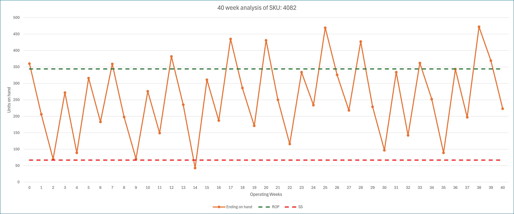

# SKU-4082 Inventory Replenishment & Disruption Simulation

## Overview
This simple excel model simulates a weekly-reviewed **(s, Q) inventory replenishment policy** for `SKU-4082` across 40 operating weeks, alongside a disruption calculator that evaluates whether to pay for expedited freight when an inbound shipment is delayed.

## Key Results
* **Replenishment Policy:** Order **360 units (15 full pallets)** whenever **Inventory Position** (On-Hand + In-Transit Orders) drops to or below **359 units** (`ROP = 359`, including **82 units of Safety Stock** for a 95% service level).
* **Pallet Optimization:** Rounding theoretical EOQ (`358.43 units`) up to `360 units` (`24 units/pallet`) adds only **$0.06/year** in cycle cost while eliminating partial-pallet breakdown labor at receiving.
* **40-Week Backtest:** Achieved a **100% fill rate** with zero stockouts, absorbing a Week 14 demand spike (`192 units`) down to **43 units** on hand.
* **Expedite Trade-Off (Week 31 Delay):** A 1-week delivery delay exposes the warehouse to **26 lost units** (`$1,170` in lost gross margin at `$45/unit`). Paying a **$450 flat expedite fee** saves **$720 in net profit** (**1.6x net ROI**; breakeven = **10 units**).

## Workbook Structure
* **`Executive Summary`:** Plain-language business brief and 40-week inventory sawtooth chart.
* **`SKU-4082`:** Parameter inputs, EOQ and Safety Stock calculations, and the 40-week simulation ledger built with `INDEX` and `SUMIFS`.
* **`Disruption Analysis`:** Dynamic expedite cost-vs.-margin decision calculator.

## Planned Next Steps
* Add a Python Monte Carlo simulation (`5,000` randomized 40-week runs) to evaluate expected fill rates and stockout probability under demand uncertainty.